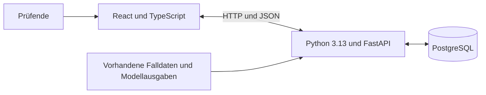

# Architektur des Forschungsprototyps

## Ziel und Umfang

Der Prototyp unterstützt die Untersuchung der Zusammenarbeit zwischen Mensch und KI bei der Validierung von Wirtschaftszweigklassifikationen. Er nutzt vorhandene Falldaten und Modellausgaben; ein KI-Modell wird zunächst nicht in der Anwendung ausgeführt. Automatische Zuordnungen werden simuliert. Entscheidungen mehrerer Prüfender sollen einzeln erfasst und ausgewertet werden können.

## Grundstruktur

- Das React-Frontend stellt die Oberfläche bereit und kommuniziert über eine REST-orientierte JSON-Schnittstelle mit dem Backend.
- Das Backend ist eine Anwendung. Import, Fallprüfung und Auswertung werden als fachlich getrennte Module organisiert.
- PostgreSQL speichert Falldaten und Prüfentscheidungen dauerhaft.
- Frontend und Backend liegen mit jeweils eigenen Abhängigkeiten im selben Repository.

## Betrieb

Die Anwendung wird zunächst lokal betrieben. Docker Compose soll Frontend, Backend und PostgreSQL gemeinsam starten; ein persistentes Volume erhält die Datenbankdaten zwischen Containerstarts. Die Teile sollen für die Entwicklung auch einzeln startbar sein. Eine spätere Bereitstellung bei einem Hosting-Anbieter bleibt möglich; ein Anbieter ist nicht festgelegt.

## Noch offen

- Datenformat und Import der vorhandenen Daten und Modellausgaben
- Konkrete Schnittstellen, Datenmodell und Organisation der Module
- Studienablauf, Fallverteilung und Auswertung
- Anforderungen an Zugang und späteren Betrieb
